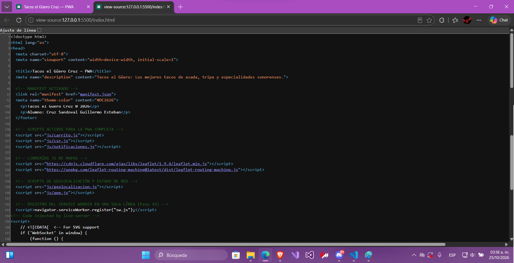
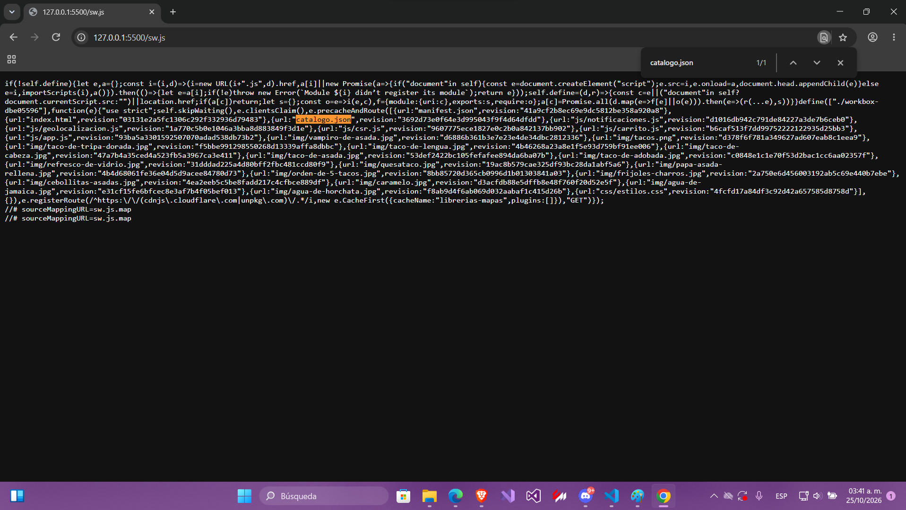

# Tacos El Güero Cruz — PWA de ventas

| Dato | Valor |
|---|---|
| **Alumno** | CRUZ SANDOVAL GUILLERMO ESTEBAN |
| **Grupo** | ING10-1 |
| **Negocio · giro** | Tacos El Güero Cruz · Taquería estilo sonorense|
| **URL del repositorio** | https://github.com/cruzsandovalguillermoesteban/tacos-el-guero-cruz-pwa-cruz-sandoval-guillermo-esteban|
| **URL de GitHub Pages** | https://cruzsandovalguillermoesteban.github.io/tacos-el-guero-cruz-pwa-cruz-sandoval-guillermo-esteban/ |

## Historial de avances

| Avance | Hash del commit entregado | Fecha |
|---|---|---|
| 1 | de7f96a1| 10/10/2026 |
| 2 | 817ec7d | 18/10/2026 |

## Comparación SSR vs CSR

### SSR (Django): los productos llegan escritos en el HTML

### CSR (JavaScript): el div del catálogo llega vacío

## Funciones PWA avance 3
### index.html: manifest y registro del Service Worker activos

### sw.js: Workbox precachea el catálogo y las fotos
